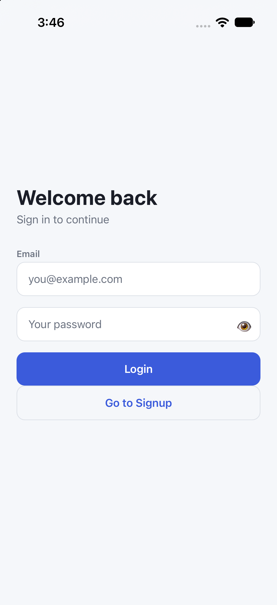
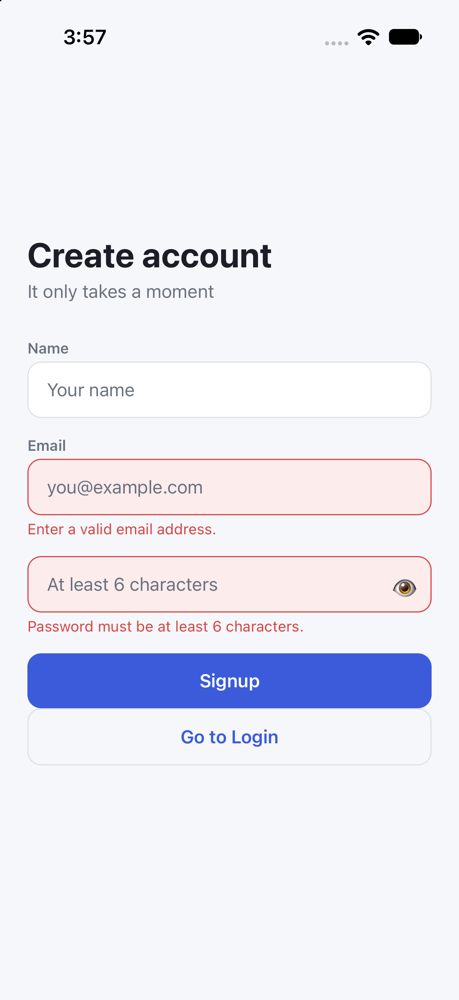
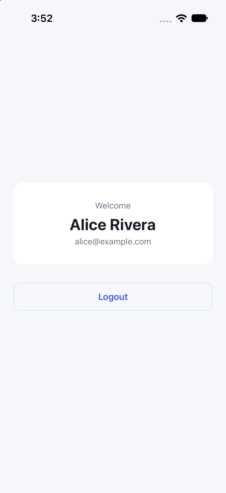

# User Authentication App

A React Native app with Login, Signup, and Home screens, built around a React Context
authentication provider. Passwords are salted and SHA-256 hashed before they are stored,
and the sensitive values live in the iOS Keychain / Android Keystore rather than in plain
storage.

There is no backend — credential checks run against local storage. That makes the app
self-contained and runnable without a server, and it is what the assignment calls for.

## Screens

| Login | Signup (error state) | Home |
|:---:|:---:|:---:|
|  |  |  |
| Email and password, with inline errors for a malformed email or bad credentials. | Name, email, and password, with errors for missing fields, a malformed email, and a password under 6 characters. | The signed-in user's name and email. Logout returns to Login. |

The eye icon on both auth screens toggles password visibility (the assignment's bonus
task).

## Features, mapped to the assignment

| Requirement | Where |
|---|---|
| 1. Auth context with `login`, `signup`, `logout`, `user` | [`src/presentation/context/AuthContext.tsx`](src/presentation/context/AuthContext.tsx) |
| 2. Login, Signup, and Home screens | [`src/presentation/screens/`](src/presentation/screens/) |
| 3. Persist authentication | [`src/infrastructure/`](src/infrastructure/) — AsyncStorage + Keychain |
| 4. React Navigation | [`src/presentation/navigation/RootNavigator.tsx`](src/presentation/navigation/RootNavigator.tsx) |
| 5. Styled UI, inputs, buttons, error messages | [`src/presentation/components/`](src/presentation/components/) |
| Bonus: password visibility toggle | [`src/presentation/components/PasswordInput.tsx`](src/presentation/components/PasswordInput.tsx) |

The context exposes exactly the four members the assignment names, plus `isLoading` while
the saved session is being restored on launch.

## Getting started

Prerequisites: follow the React Native
[environment setup guide](https://reactnative.dev/docs/set-up-your-environment) first —
Xcode and CocoaPods on macOS, or Android Studio on other platforms.

```sh
npm install
bundle install          # Ruby/CocoaPods, first clone only
bundle exec pod install # required after any native dependency change
```

Then, in one terminal:

```sh
npm start
```

And in another:

```sh
npm run ios       # or: npm run android
```

`pod install` must be re-run whenever a package with native code is added or upgraded —
this project uses `react-native-screens`, `react-native-keychain`, and AsyncStorage. A
build that fails to link them is almost always a missing `pod install`.

`npm install` also runs `patch-package`, which applies
[`patches/detox+20.51.4.patch`](patches/detox+20.51.4.patch). That one-line patch is what
lets the E2E suite focus a device window on Xcode 27, where Apple replaced `Simulator.app`
with DeviceHub — see [End-to-end tests](#end-to-end-tests). If you install with
`--ignore-scripts`, apply it yourself with `npx patch-package` or the E2E suite will still
pass, just without a visible window.

### If the iOS build fails

Both issues below are already handled in [`ios/Podfile`](ios/Podfile); they are listed here
because the errors are cryptic and the fixes are easy to undo by accident.

- **`Unicode Normalization not appropriate for ASCII-8BIT`** from `pod install` — the
  shell's locale is not UTF-8. Prefix the command:
  `LANG=en_US.UTF-8 LC_ALL=en_US.UTF-8 bundle exec pod install`
- **`/scripts/xcode/with-environment.sh: No such file or directory`** — CocoaPods 1.15
  does not propagate `REACT_NATIVE_PATH` to every pod, but React Native's script phases
  need it. The `post_install` hook sets it on all targets.

## Architecture

The app is structured as **ports and adapters**, with dependencies pointing inward:

```
infrastructure ──► application ──► domain ◄── presentation
```

```
src/
  domain/auth/       EmailAddress, PasswordHash, User, AuthError, repository interfaces
  application/auth/  SignUp, LogIn, LogOut, RestoreSession, AuthService
  infrastructure/    keychain/, storage/, hashing/, memory/, createAuthService.ts
  presentation/      components/, screens/, navigation/, context/, theme/
```

**The domain layer imports nothing** — no React, no React Native, no Keychain. It holds
the rules: what a valid email is, how long a password must be, and which failures exist.
That is what lets the auth logic be tested as plain TypeScript with no simulator and no
native mocks.

Three things the domain layer makes structurally guaranteed:

- **`EmailAddress.create()` is the only way to build one.** It validates and normalizes to
  lowercase, so `Alice@Example.com` and `alice@example.com` cannot become two accounts.
- **`invalid-credentials` is one failure kind** covering both unknown-email and
  wrong-password. Splitting them would let the app reveal which addresses are registered.
- **The domain reports failure *kinds*, not sentences.** A screen maps the kind to
  user-facing copy, so changing the wording never touches a use case.

`AuthContext` holds React state and delegates to the `AuthService` use cases — it is the
assignment's context, implemented as a presentation adapter rather than as the place the
rules live. The service is passed in as a prop from [`App.tsx`](App.tsx), which is the
composition root: `AuthContext` reaches no further than `application`, and never names an
adapter.

**Auth state drives navigation.** `RootNavigator` renders Login/Signup when there is no
user and Home when there is, so `logout()` returns to Login with no navigation call. It
also keeps a signed-in user from reaching the auth screens by swiping back.

Swapping the local store for a real API means writing three classes that implement the
existing repository interfaces and changing one line in
[`createAuthService.ts`](src/infrastructure/createAuthService.ts). No screen or use case
changes.

## Storage design

| Data | Stored in | Why |
|---|---|---|
| User profiles (id, name, email) | AsyncStorage | Non-secret; a plain JSON directory |
| Password salt and hash | Keychain / Keystore | Secret material |
| Active session (email) | Keychain / Keystore | The security-sensitive read on launch |

Passwords are never stored or compared in plaintext. Signup generates a per-user salt and
stores `sha256(salt + ":" + password)`; login recomputes and compares.

## Known limitations

Worth stating plainly rather than leaving to be discovered:

- **SHA-256 is not memory-hard.** It does not resist offline brute force of a leaked
  store. It is acceptable here because the store is device-local, but a production system
  would use argon2id or bcrypt with a server-held salt.
- **Salts are generated with `Math.random`**, which is not a cryptographically secure
  random source.
- **`verify` compares hashes in non-constant time.** Negligible against a device-local
  store, worth knowing if this moved server-side.
- **There is no backend**, so anyone with the device and Keychain access can read the
  credential store. There is also no email verification, password reset, or rate limiting
  on login attempts.

## Tests

```sh
npm test         # 64 unit and integration tests
npm run e2e:build   # build the app for Detox
npm run e2e:test    # run the Detox E2E suite against the simulator
```

Six Jest suites, 64 tests:

| Suite | Tests | Covers |
|---|---|---|
| `__tests__/domain.test.ts` | 11 | email validation and normalization, password policy, `User` |
| `__tests__/application.test.ts` | 13 | every signup/login/logout failure path against in-memory repositories |
| `__tests__/hashing.test.ts` | 13 | `Sha256PasswordHasher` — determinism, salt separation, delimiter, verify |
| `__tests__/storage.test.ts` | 16 | Keychain and AsyncStorage adapters — round trips, normalization, corrupt data |
| `__tests__/App.test.tsx` | 4 | signup → logout → login round trip against in-memory repositories |
| `__tests__/persistence.test.tsx` | 7 | the same flows against the **real** AsyncStorage and Keychain adapters |

The domain and application suites need no mocks at all — that is the payoff of the ports.
`src/infrastructure/memory/` holds real working implementations of the repository
interfaces, which is also the proof that the domain depends on interfaces rather than on
storage.

`persistence.test.tsx` is the one that closes the gap that unit tests alone leave open: it
runs the real composition root and asserts that a cold start restores the session from the
Keychain, that a stored credential rejects a wrong password, and that no plaintext password
is ever written to either store.

Other checks:

```sh
npm run typecheck
npm run lint
```

### End-to-end tests

[`e2e/auth.e2e.js`](e2e/auth.e2e.js) drives the app on a real simulator through
[Detox](https://w3c.github.io/detox/): cold start, signup, logout, login, session restore
across an app relaunch, the wrong-password error, the short-password error, and the
password toggle.

These require a machine with a desktop session — Detox needs to interact with the
simulator, so they cannot run over plain SSH or in a headless CI container without a
virtual display.

Three prerequisites are easy to miss:

- **A Metro server must be running.** `e2e:build` produces a Debug binary, which loads its
  JavaScript from `localhost:8081` at launch. Without `npm start`, the app boots to a red
  screen and every flow fails on `waitFor('Welcome back')`. If another project holds port
  8081, that project's dev server answers instead and the app fails the same way.
- **Password AutoFill must be off in the simulator.** iOS raises a **"Use Strong
  Password?"** sheet the instant an empty password field takes focus, and a **"Save
  Password?"** sheet once a signup succeeds. Both are SpringBoard UI, so Detox can neither
  see nor dismiss them, and they sit on top of the submit and logout buttons — taps land on
  the sheet and fail with "View is not hittable". Detox has no API for this
  ([wix/Detox#3761](https://github.com/wix/Detox/issues/3761)), so
  [`e2e/auth.e2e.js`](e2e/auth.e2e.js) turns AutoFill off in the simulator's configuration
  profiles in `beforeAll`. The manual equivalent is Settings → General → AutoFill &
  Passwords → AutoFill Passwords off.
- **The machine must be otherwise idle.** Detox synchronizes on the app going quiet, so a
  competing Xcode build starves the JS thread and the suite fails on timeouts rather than on
  behaviour. A full run is around 2–3 minutes on an idle machine.

The submit and logout buttons are only reachable at all because `KeyboardAvoidingView` on
each screen keeps them above the software keyboard that `replaceText` leaves open.

> **Watching it run:** Detox drives the simulator headed by default, so the interaction is
> visible whenever the device window is attached. On **Xcode 27**, `Simulator.app` is gone —
> Apple replaced it with `DeviceHub`. Detox still runs `open -a Simulator` to focus the
> device
> ([wix/Detox#4978](https://github.com/wix/Detox/issues/4978)); the failure is only logged as
> a warning and does not affect results, but it does mean no window is raised. `open -a
> DeviceHub --args -CurrentDeviceUDID <udid>` does the same job, so
> [`patches/detox+20.51.4.patch`](patches/detox+20.51.4.patch) makes
> `_openSimulatorApp` fall back to it. The patch is applied by `patch-package` on
> `postinstall`, so `npm install` keeps it — drop the `patches/` directory to go back to
> stock Detox. If you only want a recording rather than a live window, use
> `--record-videos all` instead.

> **Known state:** all six flows pass on an idle machine (verified twice, back to back).
> Under heavy competing load the two multi-step flows can still time out — that is machine
> speed, not an app defect. Re-run before trusting a failure.

## Implementation notes

The task-by-task breakdown this app was built from is in [`plans/`](plans/), and
[`AGENTS.md`](AGENTS.md) documents the conventions to follow when changing it.